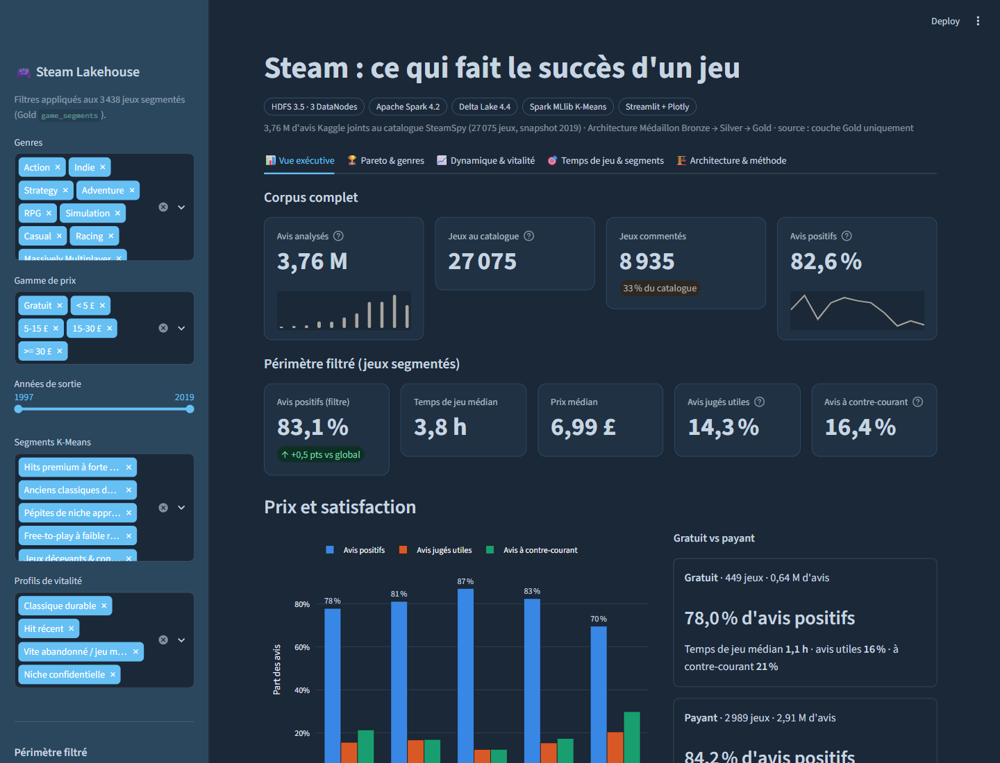
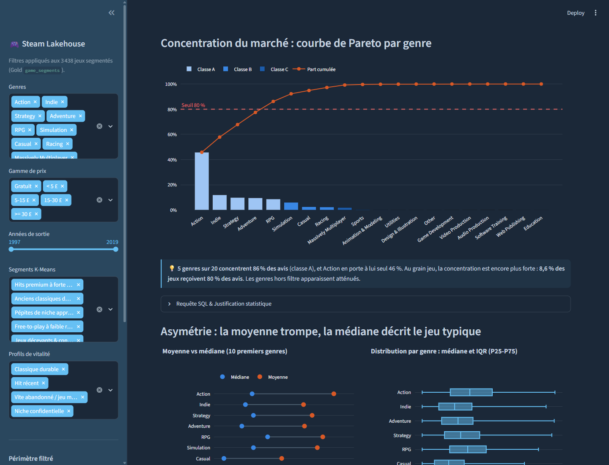
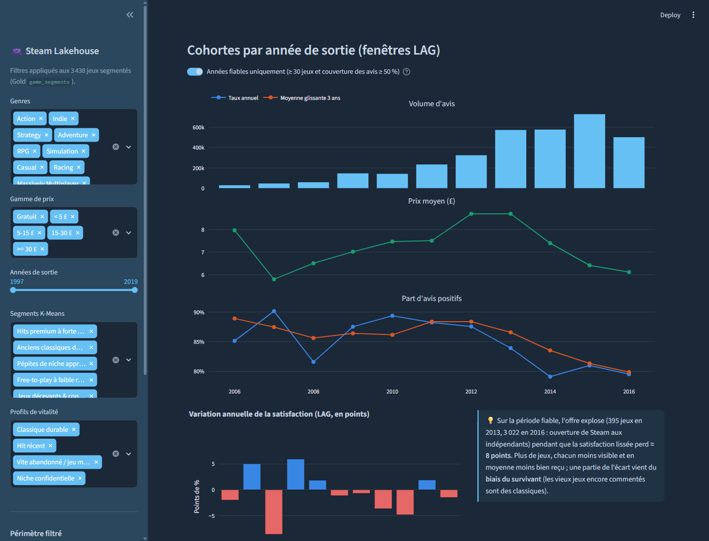
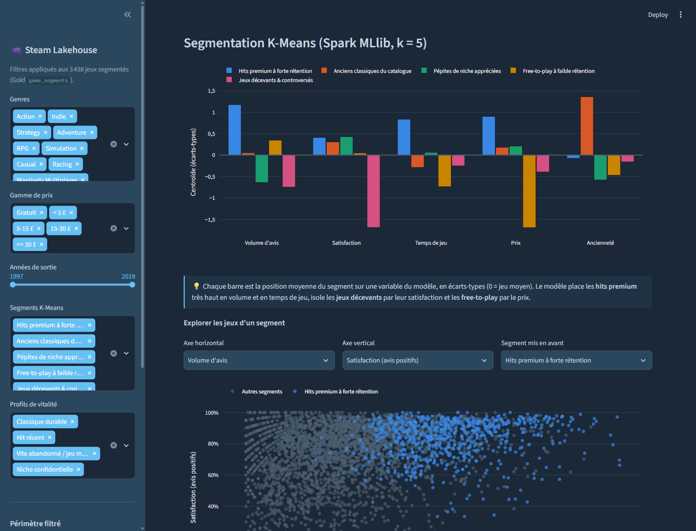
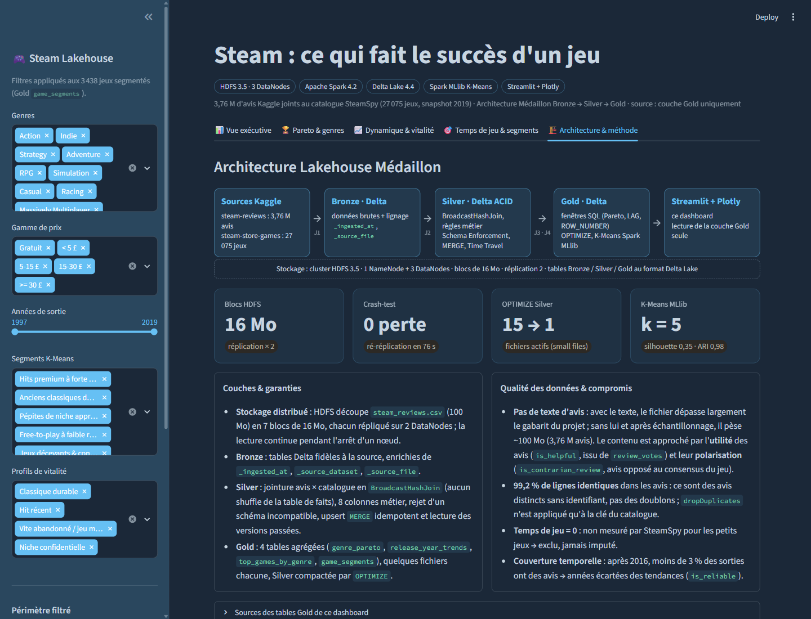

# Steam Lakehouse Analytics : ce qui fait le succès d'un jeu vidéo

**Auteurs :** **Walid Hdilou** & **Joud Atallah** (Master 2 — IPSSI Lyon)

**Data Lakehouse Médaillon de bout en bout sur un cluster HDFS distribué** : 3,76 millions d'avis Steam et
27 075 jeux traversent les couches Bronze → Silver → Gold (Apache Spark + Delta Lake), alimentent des tests
statistiques et une segmentation K-Means (Spark MLlib), puis un dashboard décisionnel Streamlit.

 
 
 

---

## Résumé exécutif

| | |
|---|---|
| **Question métier** | Quels facteurs (prix, genre, ancienneté, temps de jeu) sont associés à une meilleure réception des joueurs, et peut-on segmenter les jeux en profils actionnables ? |
| **Données** | [`andrewmvd/steam-reviews`](https://www.kaggle.com/datasets/andrewmvd/steam-reviews) (faits : 3 763 740 avis, ~100 Mo) × [`nikdavis/steam-store-games`](https://www.kaggle.com/datasets/nikdavis/steam-store-games) (dimension : 27 075 jeux), jointure `app_id = appid` |
| **Architecture** | Cluster HDFS 1 NameNode + 3 DataNodes (blocs 16 Mo, réplication 2) → Bronze → Silver → Gold en Delta Lake → Streamlit |
| **Livrables** | 4 notebooks exécutés (J1 → J4), 4 tables Gold, dashboard en 5 onglets, tests automatisés (`task test:all`, `task test:dashboard`) |

### Résultats clés

- **Marché très concentré** : 5 genres sur 20 portent 86 % des avis, et **8,6 % des jeux concentrent 80 % des avis** (Pareto, fenêtres SQL).
- **Le prix joue en cloche** : les jeux à 5-15 £ sont les mieux notés (84 % d'avis positifs en médiane) ; gratuits et jeux ≥ 30 £ déçoivent davantage (Kruskal-Wallis, p ≈ 5·10⁻³⁷).
- **Le temps de jeu aide, mais peu** : corrélation positive et faible avec la satisfaction (Spearman ρ = +0,13).
- **Les critiques comptent** : un avis négatif est **1,9 fois plus souvent jugé utile** qu'un avis positif (χ², V de Cramér = 0,12).
- **5 segments K-Means** (k = 5, silhouette 0,35, accord Spark MLlib / scikit-learn ARI = 0,98) : *Hits premium à forte rétention* (67 % des avis), *Anciens classiques*, *Pépites de niche*, *Free-to-play à faible rétention*, *Jeux décevants & controversés* (41 % d'avis positifs).
- **Vitalité** : les « classiques durables » (≥ 5 ans et toujours joués) sont les mieux notés (86 % d'avis positifs).

---

## Architecture Médaillon

```text
  Kaggle (CSV)                 Cluster HDFS 3.5 : 1 NameNode + 3 DataNodes
                               blocs 16 Mo · réplication 2 · panne détectée en ~50 s
  ┌──────────────────┐         ┌──────────────────────────────────────────────────────────────────┐
  │ steam_reviews    │   J1    │ BRONZE (Delta)   données brutes + lignage                        │
  │ 3,76 M avis      ├────────►│   _ingested_at, _source_dataset, _source_file                    │
  │ steam_games      │ ingest. ├──────────────────────────────────────────────────────────────────┤
  │ 27 075 jeux      │         │ SILVER (Delta ACID)   1 ligne = 1 avis enrichi du catalogue      │
  └──────────────────┘   J2    │   BroadcastHashJoin · 8 colonnes métier                          │
                     nettoyage │   Schema Enforcement · MERGE INTO · Time Travel                  │
                      jointure ├──────────────────────────────────────────────────────────────────┤
                               │ GOLD (Delta)   4 tables agrégées                                 │
                       J3 · J4 │   genre_pareto (DENSE_RANK, cumul)                               │
                    Spark SQL  │   release_year_trends (LAG) · top_games_by_genre (ROW_NUMBER)    │
                   + MLlib     │   game_segments (K-Means MLlib) · Silver compactée (OPTIMIZE)    │
                               └─────────────────────────────────┬────────────────────────────────┘
                                                                 │ lecture de la couche Gold uniquement
                                                  ┌──────────────▼─────────────┐
                                                  │ Streamlit + Plotly · :8501 │
                                                  └────────────────────────────┘
```

| Couche | Tables Delta sur HDFS |
|---|---|
| Bronze | `/lakehouse/bronze/steam_reviews`, `/lakehouse/bronze/steam_games` |
| Silver | `/lakehouse/silver/steam_reviews_enriched` (3 763 740 avis × 31 colonnes), `/lakehouse/silver/steam_games` |
| Gold | `/lakehouse/gold/genre_pareto`, `/lakehouse/gold/release_year_trends`, `/lakehouse/gold/top_games_by_genre`, `/lakehouse/gold/game_segments` |

## Stack technique

| Domaine | Technologies |
|---|---|
| Infrastructure | Docker Compose, Ubuntu 26.04 (images multi-architecture amd64 / arm64), go-task |
| Stockage distribué | Apache Hadoop HDFS 3.5 (1 NameNode + 3 DataNodes, blocs 16 Mo, réplication 2) |
| Calcul | Apache Spark 4.2 (PySpark, Spark SQL, fenêtres analytiques), Python 3.15 |
| Format de table | Delta Lake 4.4 (ACID, Schema Enforcement, MERGE, Time Travel, OPTIMIZE) |
| Statistiques & ML | SciPy (Spearman, Kruskal-Wallis, Mann-Whitney, χ²), Spark MLlib (VectorAssembler, StandardScaler, KMeans), scikit-learn (validation croisée de la segmentation) |
| Restitution | Streamlit 1.67, Plotly 7, thème sombre inspiré de Steam |
| Qualité | Ruff, pytest + `streamlit.testing` (AppTest), exécution nbconvert des notebooks |

---

## Dashboard

Le dashboard lit **uniquement la couche Gold** (4 tables Delta, mises en cache) et s'organise en 5 onglets,
chacun avec un éclairage métier et la requête SQL + la justification statistique de chaque analyse :

| Onglet | Contenu |
|---|---|
| **Vue exécutive** | KPI du corpus (avis, jeux, satisfaction) avec mini-tendances, KPI du périmètre filtré avec écarts, satisfaction / utilité / polarisation par gamme de prix, gratuit vs payant |
| **Pareto & genres** | Courbe de Pareto (seuil 80 %, classes A/B/C), moyenne vs médiane, distributions médiane + IQR, top 10 par genre (borne de Wilson) |
| **Dynamique & vitalité** | Cohortes annuelles en petits multiples (volume, prix, satisfaction), variations `LAG`, profils de vitalité « toujours joué vs jeu mort » |
| **Temps de jeu & segments** | Satisfaction par tranche de temps de jeu, centroïdes K-Means, exploration interactive d'un segment, recommandations stratégiques |
| **Architecture & méthode** | Pipeline Médaillon, chiffres clés de l'infrastructure, qualité des données et compromis |

Filtres de la barre latérale : genres, gamme de prix, années de sortie, segments K-Means, profils de vitalité.

### Aperçu

Captures du dashboard sur les vraies tables Gold (dossier [`docs/screenshots/`](docs/screenshots/)).

**Vue exécutive** : KPI du corpus et du périmètre filtré, satisfaction par gamme de prix, gratuit vs payant.



**Pareto & genres** : concentration du marché (seuil 80 %), moyenne vs médiane et distributions IQR.



**Dynamique & vitalité** : cohortes annuelles en petits multiples et variations `LAG`.



**Temps de jeu & segments** : centroïdes K-Means et exploration interactive d'un segment.



**Architecture & méthode** : pipeline Médaillon, chiffres clés de l'infrastructure, qualité des données.



---

## Lancer le projet

Prérequis : Docker Desktop (8 Go de RAM recommandés) et [go-task](https://taskfile.dev) (ou `mise install`).

```bash
# 1. Construire les images et démarrer le cluster (attend les 3 DataNodes, Jupyter et Streamlit)
task up

# 2. Télécharger les deux datasets Kaggle, puis placer les fichiers préparés (voir la note ci-dessous) :
#    data_raw/steam-reviews/steam_reviews.csv et data_raw/steam-store-games/steam_games.csv
task data:download DATASET="andrewmvd/steam-reviews,nikdavis/steam-store-games"

# 3. Exécuter le pipeline complet J1 → J4 (Bronze, Silver, Gold) et valider l'infrastructure
task test:all

# 4. Ouvrir le dashboard puis lancer ses tests automatisés
#    http://localhost:8501
task test:dashboard
```

> **Préparation des avis** : le fichier Kaggle complet (`dataset.csv`, 6,4 M avis avec leur texte) est
> réduit hors dépôt aux colonnes `app_id, app_name, review_score, review_votes`, filtré sur les jeux présents
> dans le catalogue (5,86 M avis), puis échantillonné uniformément (ratio 0,6423, graine 42) pour obtenir
> `steam_reviews.csv` : 3 763 740 avis, ~100 Mo. Les données ne sont jamais versionnées (`data_raw/` est
> ignoré par Git).

| Service | URL |
|---|---|
| **Dashboard Streamlit** | http://localhost:8501 |
| JupyterLab (token `bigdata`) | http://localhost:8888 |
| HDFS NameNode UI | http://localhost:9870 |
| Spark Web UI (session active) | http://localhost:4040 |

## Structure du dépôt

```text
.
├── app/
│   ├── dashboard.py            # Dashboard Streamlit (5 onglets, lecture Gold uniquement)
│   └── test_dashboard.py       # Tests AppTest : rendu, filtres, cas vides (task test:dashboard)
├── notebooks/
│   ├── J1_HDFS_Ingestion_Bronze.ipynb        # HDFS, blocs 16 Mo, crash-test DataNode, Bronze
│   ├── J2_Spark_Delta_Silver.ipynb           # Qualité, BroadcastHashJoin, ACID, MERGE, Time Travel
│   ├── J3_Analytics_SQL_Gold.ipynb           # Skewness, Pareto, LAG, ROW_NUMBER, OPTIMIZE
│   └── J4_Stats_Segmentation_Dashboard.ipynb # Tests SciPy, EDA, K-Means Spark MLlib, Gold segments
├── docs/screenshots/           # Captures du dashboard pour ce README
├── config/                     # core-site.xml, hdfs-site.xml (16 Mo, réplication 2), spark-defaults.conf
├── docker/                     # Images Hadoop HDFS 3.5 et workspace PySpark / Delta / Streamlit
├── docker-compose.yml          # 1 NameNode + 3 DataNodes + JupyterLab + Streamlit (thème Steam)
├── Taskfile.yml                # Démarrage, crash-test, tests J1..J4 et dashboard
└── data_raw/                   # Datasets Kaggle locaux (jamais versionnés)
```

## Ce que démontre chaque étape

| Étape | Notions mises en œuvre | Preuves dans le notebook |
|---|---|---|
| **J1 · HDFS & Bronze** | Découpage en blocs, réplication, tolérance aux pannes, data locality | 7 blocs de 16 Mo pour 100 Mo ; arrêt de `datanode2` : lecture continue, 0 bloc perdu, ré-réplication en 76 s |
| **J2 · Silver** | Nettoyage, jointure distribuée, garanties ACID | `BroadcastHashJoin` dans `explain()`, schéma incompatible rejeté, `MERGE` idempotent (500 insertions + 500 mises à jour), Time Travel |
| **J3 · Gold** | Statistiques robustes, fenêtres SQL, small files | Skewness 14,6 → médiane + IQR ; Pareto `DENSE_RANK`, `LAG`, `ROW_NUMBER` + borne de Wilson ; `OPTIMIZE` 15 → 1 fichier |
| **J4 · Stats & ML** | Tests non paramétriques, EDA, K-Means | 3 tests avec H0/H1 et tailles d'effet ; `log1p` + `StandardScaler` ; k par coude + silhouette ; segments nommés et validés |

### Choix méthodologiques assumés

- **Pas de texte d'avis** : écarté à l'ingestion pour respecter le dimensionnement ; compensé par l'utilité des avis (`is_helpful`) et leur polarisation (`is_contrarian_review`).
- **99,2 % de lignes identiques** dans les avis : ce sont des avis distincts sans identifiant ; le dédoublonnage ne porte que sur la clé du catalogue.
- **Temps de jeu = 0** : valeur non mesurée par SteamSpy pour les petits jeux, exclue et jamais imputée.
- **Biais de collecte après 2016** (moins de 3 % des sorties couvertes) : années écartées des tendances (`is_reliable`).

---

## Environnement technique du cours

Environnement pédagogique compatible nativement **`linux/amd64` (PC x86_64 / WSL2)** et **`linux/arm64` (Apple Silicon M1–M4 / Linux ARM64)** sur **Ubuntu 26.04 LTS**, reposant sur un **cluster HDFS 3.5 réel distribué (1 NameNode + 3 DataNodes)** avec blocs réduits à **16 Mo** et détection de panne abaissée à **~50 secondes**, couplé à une image mutualisée légère (`ubuntu:26.04` + **Python 3.15** via `uv` + OpenJDK 21 + JARs Delta pré-embarqués) pour **PySpark 4.2**, **Delta Lake 4.4**, **JupyterLab 4.6** et **Streamlit**.

### Travailler dans VS Code (Kernel Jupyter & Conteneur pré-configurés)

**Option A — Mode Dev Container intégré** *(auto-complétion PySpark, Ruff, Git & Kernel en 1 clic)*
1. Ouvrez ce dossier dans VS Code et installez l'extension recommandée **Dev Containers** (`ms-vscode-remote.remote-containers`).
2. Cliquez sur **Reopen in Container** (ou `Ctrl+Shift+P` → `Dev Containers: Reopen in Container`).
3. VS Code vous connecte directement dans `spark-jupyter` (`/workspace`) avec le kernel **`Python 3.15 (PySpark 4.2 + Delta Lake 4.4)`**.

**Option B — Mode léger depuis l'hôte** *(idéal pour les PC portables à 8 Go de RAM)*
1. Lancez `task up`.
2. Ouvrez un notebook dans `notebooks/`, cliquez sur **Select Kernel** → **Existing Jupyter Server...** → `http://localhost:8888/?token=bigdata`.

### Commandes `task` principales (`Taskfile.yml`)

```bash
task up                                  # Démarrer le cluster et attendre les 3 DataNodes + Jupyter + Streamlit
task status                              # État des conteneurs et rapport HDFS (dfsadmin -report)
task data:download DATASET="a/ds1,b/ds2" # Télécharger un ou plusieurs datasets dans data_raw/<nom>/
task hdfs:ls                             # Lister l'occupation disque des couches Bronze / Silver / Gold
task hdfs:fsck                           # Inspecter les blocs de 16 Mo et leurs DataNodes hôtes
task hdfs:crash-dn2                      # [TP Jour 1] Couper datanode2 pour observer l'auto-réparation en ~50s
task hdfs:restore-dn2                    # [TP Jour 1] Relancer datanode2
task test:docker                         # Vérifier la santé de HDFS, JupyterLab et Streamlit
task test:notebooks                      # Exécuter et valider les 4 notebooks (J1 -> J4)
task test:dashboard                      # Tester le dashboard sur les vraies tables Gold (AppTest)
task test:all                            # Infrastructure + notebooks J1 -> J4
task down                                # Arrêter les conteneurs (conserve les volumes HDFS)
task clean                               # Arrêter et purger les volumes HDFS
```

<details>
<summary><b>Consignes du TP : critères de choix des datasets Kaggle</b></summary>

Chaque étudiant / groupe **choisit librement sa thématique métier et combine un dataset multi-tables ou plusieurs datasets publics complémentaires sur Kaggle** (croisés par jointure distribuée) pour construire de bout en bout une architecture **Data Lakehouse Médaillon (Bronze → Silver → Gold → Dashboard)**. Critères :

1. **Volumétrie cumulée : ~50 Mo à 500 Mo** (avec au moins un fichier dépassant **20 à 32 Mo** afin d'observer physiquement le découpage multi-blocs de **16 Mo** sur HDFS au Jour 1).
2. **Axe de jointure clair entre tables / datasets** : jointure temporelle (`date`, `yyyy-MM`), géographique (code pays ISO, ville, code postal) ou par identifiant / nomenclature métier (`product_id`, `category`, `station_id`).
3. **Richesse des attributs** : au moins une colonne temporelle (séries et `LAG`), des variables quantitatives continues (asymétrie, médiane vs moyenne, IQR, tests du Jour 4) et des dimensions catégorielles ou géographiques (*Broadcast Hash Join* sans explosion N-à-M).

</details>
